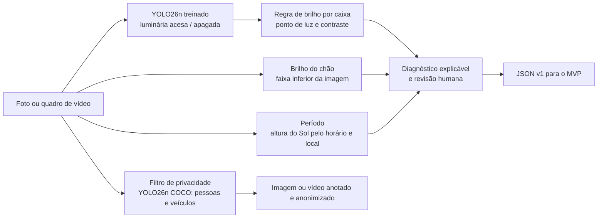

# Luz Segura · visão computacional

Detecção de **luminárias públicas acesas e apagadas** e de **trechos escuros** em fotos e vídeos noturnos,
com um detector YOLO26n treinado pela equipe, conferência de cada luminária por medição de brilho e um
diagnóstico explicável que o MVP do Luz Segura consome por API.

Entrega de **Applied Computer Vision** ("Enxergando o mundo real") da FIAP Global Solution 2026.2,
CitizenTech, Engenharia de Software 4º ano (4ES). Professores: Arnaldo Viana e Paulo Rodrigues.

- **Relatório técnico (PDF):** [docs/Relatorio_LuzSegura_ACV.pdf](docs/Relatorio_LuzSegura_ACV.pdf)
- **Vídeo de demonstração:** [docs/video/luz_segura_demo.mp4](docs/video/luz_segura_demo.mp4) (legendado; roteiro e
  créditos em [docs/video/roteiro.md](docs/video/roteiro.md))
- **Contrato da API com o MVP:** [docs/contrato_api.md](docs/contrato_api.md)

## Integrantes

| Nome | RM |
|---|---|
| Arthur Bessa Pian | RM99215 |
| Davi Almeida Desenzi | RM550849 |
| Fabrício Gutierrez Saavedra | RM97631 |
| João Victor Soares | RM551410 |
| Márcio Gastaldi de Oliveira Soares | RM98811 |

## Ficha técnica

| Item | Descrição |
|---|---|
| Problema | Luminária queimada e rua escura deixam pedestres e quem espera ônibus inseguros; a prefeitura só fica sabendo por reclamação, mal localizada e sem prioridade. |
| Papel no MVP | O componente que **enxerga** o problema: recebe a foto do cidadão (ou o vídeo de uma ronda) e devolve um diagnóstico em JSON, com prioridade, explicação e a indicação de revisão humana. |
| Entrada | Foto JPEG, PNG ou WebP (app, API ou linha de comando); vídeo ou webcam (linha de comando e app). |
| Saída | Contrato JSON v1: diagnóstico (`luminaria_apagada`, `iluminacao_insuficiente`, `trecho_escuro`, `iluminacao_adequada`, `fora_do_periodo_noturno` e, em caráter experimental, `acesa_durante_o_dia`), severidade, `requer_revisao_humana`, explicação em português, contagens, brilho e caixas; imagem anotada, com as pessoas e os veículos detectados já desfocados. |
| Modelo | YOLO26n (Ultralytics, pré-treinado no COCO) treinado pela equipe com 2 classes: `luminaria_acesa` e `luminaria_apagada`. |
| Vídeo | Quadro a quadro, com rastreamento ByteTrack (cada luminária contada uma vez), só com CPU. O detector sozinho passa de 30 quadros/s; o pipeline completo (detecção, rastreamento, brilho, privacidade e diagnóstico) roda a cerca de 16 a 20 quadros/s numa CPU de desktop com 8 threads, perto de 60% dos 29,97 quadros/s dos vídeos testados. Exportação opcional para ONNX Runtime. |
| Privacidade | Nada fica guardado: a API analisa a foto na memória e não grava nada em disco, e o app mantém os arquivos só temporariamente (veja "Privacidade e uso responsável"). Pessoas e veículos (placas) detectados pelo filtro são desfocados antes de o resultado ser exibido; à noite ou em ângulos incomuns, algum pode escapar do filtro. |
| Dados | Só dados públicos ou simulados: nada foi fotografado ou filmado pela equipe. |

## Como funciona



1. **Detector treinado.** O YOLO26n encontra cada luminária e diz se ela está acesa ou apagada.
2. **Regra de brilho, sem aprendizado de máquina.** Na área de cada caixa: luminária acesa tem uma mancha
   saturada de pelo menos 6 px; apagada não tem mancha e não é mais clara que o entorno. Quando o brilho
   contradiz ou não confirma a luminária apagada, o resultado vai para revisão humana.
3. **Brilho do chão.** A faixa de baixo da imagem (40% da altura) mostra se o trecho está escuro. Como numa
   foto apontada para cima essa faixa mostra céu ou fachada, vão para revisão humana os diagnósticos de chão
   escuro (iluminação insuficiente e trecho escuro) e a iluminação adequada sem nenhuma luminária encontrada
   na foto, que vem só do brilho do chão.
4. **Período pela posição do Sol.** Com horário (com fuso) e localização, o sistema calcula a altura do Sol
   (algoritmo da NOAA): luminária apagada só é falha depois do pôr do sol. O modo noturno do celular deixa a
   foto clara, por isso o brilho da imagem é só o último recurso. O cliente também pode informar o período
   (`periodo` na API, "Período" no app e `--periodo` na linha de comando), que então tem prioridade: foi o
   caso da avaliação em Chennai, cujas fotos não têm horário nem local e foram analisadas com o período
   informado como noite.
5. **Diagnóstico e prioridade.** Chamado automático só sai para luminária apagada confirmada pelo brilho, à
   noite, com o período conhecido e confiança de pelo menos 0,55 (ou, de dia e com o Sol alto, para
   luminária acesa confirmada pelo brilho, no diagnóstico experimental de fotocélula); o resto vai para a
   fila de revisão humana ou não gera chamado. A explicação diz por quê.

## Resultados

Todos os conjuntos de avaliação ficaram fora do treino. Os números completos, as tabelas e a análise
estão no [relatório](docs/Relatorio_LuzSegura_ACV.pdf); os arquivos de origem estão em `results/`.

| Avaliação | Conjunto | Resultado |
|---|---|---|
| Detecção | teste reservado do Open Images (524 imagens) | mAP50 0,441 e mAP50-95 0,216 (acesa 0,463; apagada 0,419, mas 255 das 497 caixas apagadas são luminárias de dia, rotuladas apagadas por convenção; à noite, acesa 0,48 e apagada 0,26, esta medida em só 22 caixas) |
| Ponta a ponta | 816 fotos de Chennai (289 com defeito) | precisão de 87,3% e revocação de 21,5% na luminária apagada; chamados automáticos: 8, todos certos, com o período informado como noite (as fotos não têm horário nem local) |
| Ponta a ponta | 398 chamados noturnos reais de luminária queimada (SF 311) | falha apontada em 10,6%, sempre com revisão humana; em 41,5% nenhuma luminária foi encontrada (vai para revisão); em 38,9% só luminárias acesas, com iluminação adequada sem revisão (o ponto cego) |
| Período pela posição do Sol | 60 chamados diurnos do SF 311 (luz acesa o tempo todo) | nenhuma falha falsa; o diagnóstico experimental acesa durante o dia reconheceu só 3 dos 60 (5%) |
| Velocidade | vídeo 1280×720 em CPU (Ryzen 7 5700X3D, 8 threads) | detector sozinho: 35,0 quadros/s em PyTorch e 45,8 em ONNX; pipeline completo em PyTorch, com privacidade em todo quadro: 15,8 quadros/s |
| Vídeo | 10 trechos noturnos de São Paulo (5,4 min, a 29,97 quadros/s) | pipeline completo a 17,8–19,8 quadros/s, de 59% a 66% do ritmo dos vídeos; 129 trilhas classificadas como acesas (sem gabarito; incluem faróis de carros) e 2 apagadas, ambas enviadas à revisão humana |

O sistema é preciso: o que ele aponta como luminária apagada costuma estar certo, e, quando a evidência é
fraca, o caso vai para revisão humana. Quando não encontra nenhuma luminária na foto, também manda o caso
para revisão, porque o resultado vem só do brilho do chão. As limitações principais são duas. A primeira é
a revocação em fotos noturnas de celular: muitas luminárias apagadas ainda escapam ao detector. A segunda é
o ponto cego que isso cria: quando só encontra luminárias acesas e o brilho não as contradiz, o sistema
responde iluminação adequada sem revisão, mesmo que a luminária queimada do relato esteja fora do quadro
ou não tenha sido detectada; por isso, no MVP, iluminação adequada não encerra sozinha o relato de um
cidadão. O diagnóstico acesa durante o dia é experimental: no treino, toda luminária de dia foi rotulada
como apagada, e o modelo vê como apagada até a luminária acesa de dia. O relatório discute as causas e os
próximos passos.

## Como rodar

Requisitos: Python 3.12 (testado no 3.12.10), Windows 11 ou Linux, só CPU; Edge, Chrome ou Chromium só
para gerar o PDF do relatório.

```bash
python -m venv .venv
# Windows: .venv\Scripts\activate    Linux: source .venv/bin/activate
pip install -r requirements.txt      # em Linux, instale antes o torch para CPU (veja o topo do arquivo)
pip install -e .
```

Os pesos treinados estão em `models/luzsegura_yolo26n.pt`, e os resultados e limiares publicados são
desses pesos `.pt`. A exportação `models/luzsegura_yolo26n.onnx` é opcional (`--pesos`) e tem entrada fixa
de 640×640: a imagem é completada até ficar quadrada, por isso a confiança muda um pouco em fotos que não
são quadradas. O filtro de privacidade usa o `yolo26n.pt` do COCO, que o Ultralytics baixa sozinho na
primeira execução.

### Interface web (foto e vídeo)

```bash
luzsegura app            # abre em http://127.0.0.1:7860
```

### Linha de comando

```bash
# Foto: com horário (com fuso) e local, o período sai da posição do Sol
luzsegura foto rua.jpg --saida anotada.jpg --json resultado.json --lat -23.55 --lon -46.63 --quando 2026-11-18T21:30:00-03:00

# Vídeo noturno (ou a webcam, com --webcam 0), com resumo do trajeto
luzsegura video ronda.mp4 --saida ronda_anotada.mp4 --resumo resumo.json --mostrar
```

### API para o MVP

```bash
luzsegura api            # documentação interativa em http://127.0.0.1:8000/docs
curl -F "arquivo=@rua.jpg" -F "lat=-23.55" -F "lon=-46.63" -F "capturado_em=2026-11-18T21:30:00-03:00" \
     http://127.0.0.1:8000/v1/analisar
```

Campos, códigos de erro, regras de revisão humana e quem consome cada campo estão em
[docs/contrato_api.md](docs/contrato_api.md).

### Testes

```bash
pytest
```

No Git Bash do Windows, rode os scripts com `python -X utf8` (ou defina `PYTHONUTF8=1`) para os acentos
aparecerem certos no terminal.

## Reproduzir do zero

```bash
python scripts/reproduzir.py                 # dados, dataset, treino (cerca de 4 h em CPU), avaliação, demo e relatório
python scripts/reproduzir.py --pular-treino  # usa os pesos versionados em models/
```

| Etapa | O que faz | Scripts |
|---|---|---|
| dados | baixa Open Images, Chennai, SF 311 e vídeos refazendo exatamente as linhas dos manifestos; remove fotos repetidas | `scripts/dados/baixar_*.py`, `deduplicar_manifestos.py` |
| dataset | mede o brilho de cada caixa, define o estado (acesa ou apagada), simula noites a partir de fotos diurnas e monta treino, validação e teste | `analisar_luminancia.py`, `montar_dataset.py` |
| treino | treina o YOLO26n e resume as épocas | `scripts/treino/treinar.py`, `resumir_treino.py` |
| avaliacao_v1 | teste de detecção e avaliação ponta a ponta (Chennai e SF 311) | `scripts/avaliacao/avaliar_deteccao.py`, `avaliar_imagens.py` |
| v2 | pseudo-rótulos do v1 em fotos de chamados reais separadas da avaliação (o v2 só é treinado com `--com-v2`) | `montar_dataset_v2.py` |
| comparar | escolhe o modelo final por regra fixada antes e publica os resultados dele | `comparar_modelos.py` |
| benchmark | quadros por segundo em CPU (PyTorch e ONNX Runtime) | `benchmark_fps.py` |
| demo | exemplos de fotos, vídeos anotados e o vídeo de demonstração | `scripts/demo/*.py` |
| relatorio | relatório em HTML e PDF, com todos os números lidos de `results/` | `scripts/docs/gerar_relatorio.py` |

## Estrutura

```
src/luzsegura/        pacote: detector, regra de brilho, período solar, diagnóstico, privacidade,
                      desenho, vídeo, API (FastAPI), app (Gradio) e linha de comando
tests/                testes automatizados (pytest)
scripts/              dados, treino, avaliação, demonstração, relatório e reproduzir.py
models/               pesos treinados (.pt e .onnx com o selo SHA-256 do .pt)
data/manifests/       manifestos versionados: origem de cada imagem e vídeo e rótulos das imagens; autor
                      e licença por foto (Open Images) e por vídeo
results/              métricas, gráficos, exemplos anonimizados e resumos dos vídeos
docs/                 relatório (PDF e HTML), contrato da API, vídeo de demonstração e roteiro do vídeo
```

`data/raw`, `data/dataset` e os demais intermediários não são versionados: saem dos scripts.

## Dados e licenças

Nenhuma foto ou vídeo foi feito pela equipe.

| Fonte | Uso | Licença | No repositório |
|---|---|---|---|
| [Open Images V7](https://storage.googleapis.com/openimages/web/index.html), classe "Street light" | treino, validação e teste do detector | anotações CC BY 4.0 (Google); fotos CC BY 2.0 de cada autor | manifestos (`openimages_*.csv`, com autor e link de cada foto); das fotos, só as de exemplo, anotadas e anonimizadas, em `results/exemplos/`, com crédito em `creditos.csv` |
| Noites simuladas | treino de luminárias apagadas à noite | derivadas de fotos diurnas do Open Images | não (geradas pelos scripts) |
| [Dataset de Chennai](https://github.com/Team16Project/Street-Light-Dataset) (arXiv:2407.01117) | só avaliação (luminárias funcionando e com defeito) | sem licença declarada | só os links (`chennai_imagens.csv`); as imagens nunca são redistribuídas |
| [San Francisco 311](https://data.sf.gov/resource/vw6y-z8j6) (DataSF) | avaliação com chamados reais; conjunto separado para a tentativa de autotreinamento | ODC PDDL (domínio público) | manifestos (`sf311*.csv`); fotos só anonimizadas, nos exemplos e no vídeo de demonstração |
| Vídeos noturnos do Internet Archive (Avenida Paulista, São Paulo) | demonstração da análise de vídeo | domínio público (CC0) | manifesto (`videos.csv`); trechos anotados no vídeo de demonstração |
| [YOLO26n](https://docs.ultralytics.com/models/yolo26/) (Ultralytics) | pesos iniciais e filtro de privacidade | AGPL-3.0 | não (baixado pelo Ultralytics) |

Os créditos de cada foto mostrada no relatório estão em `results/exemplos/creditos.csv`, e os de cada trecho
do vídeo, no próprio vídeo e em `docs/video/roteiro.md`.

## Privacidade e uso responsável

- **LGPD:** nada fica guardado. A API analisa a foto na memória e não grava nada em disco. O app mantém a
  foto ou o vídeo enviado, e os resultados, só no cache temporário dele, apagado em até 20 minutos (ou ao
  fechar o app); o último vídeo anotado, já anonimizado, fica numa pasta temporária até a próxima análise
  de vídeo ou até o app ser fechado. Pessoas e veículos detectados pelo filtro de privacidade são desfocados
  antes de o resultado ser exibido; à noite ou em ângulos incomuns, algum pode escapar do filtro. O campo
  `privacidade` do JSON registra se o filtro estava ativo e quantas pessoas e veículos foram desfocados.
- **Revisão humana:** o sistema não abre chamado sozinho quando a evidência é fraca: brilho que contradiz o
  modelo, confiança baixa, horário de transição, período estimado só pelo brilho ou diagnóstico tirado do
  chão, inclusive iluminação adequada sem nenhuma luminária encontrada na foto. A explicação em português
  diz o motivo. Iluminação adequada com luminárias acesas encontradas não passa por revisão, por isso não
  deve encerrar sozinha o relato de um cidadão.
- **Dados documentados:** cada imagem e vídeo tem a origem registrada nos manifestos; autor e licença estão
  por foto no Open Images e nos vídeos, e por fonte na tabela acima (SF 311: ODC PDDL; Chennai: sem licença
  declarada). Os conjuntos de avaliação (Chennai e SF 311) nunca entram no treino, e as fotos repetidas
  foram removidas.
- **Limitações:** as principais são a revocação baixa em fotos noturnas de celular, o ponto cego da
  iluminação adequada sem revisão, o diagnóstico experimental de luminária acesa durante o dia e o filtro de
  privacidade, que à noite ou em ângulos incomuns pode deixar passar alguma pessoa ou algum veículo. O
  relatório (seção de conclusão) discute essas e outras limitações e os vieses conhecidos, com os números de
  cada conjunto.

## Referências

1. ULTRALYTICS. YOLO26. Documentação oficial, 2026. https://docs.ultralytics.com/models/yolo26/
2. KUZNETSOVA, A. et al. The Open Images Dataset V4. International Journal of Computer Vision, v. 128, p. 1956-1981, 2020. https://doi.org/10.1007/s11263-020-01316-z
3. S, E. F. S.; T, S.; P, S. K.; S, J. S. Comprehensive Dataset for Urban Streetlight Analysis. arXiv:2407.01117, 2024. https://github.com/Team16Project/Street-Light-Dataset
4. SAN FRANCISCO 311. 311 Cases (Streetlights). DataSF, licença ODC PDDL. https://data.sf.gov/resource/vw6y-z8j6
5. ZHANG, Y. et al. ByteTrack: Multi-Object Tracking by Associating Every Detection Box. ECCV, 2022. https://arxiv.org/abs/2110.06864
6. NOAA GLOBAL MONITORING LABORATORY. Solar Calculation Details. https://gml.noaa.gov/grad/solcalc/calcdetails.html
7. KUMAR, S. et al. Urban Street Lighting Infrastructure Monitoring Using a Mobile Sensor Platform. IEEE Sensors Journal, v. 16, n. 12, p. 4981-4994, 2016. https://doi.org/10.1109/JSEN.2016.2552249
8. MAVROMATIS, I. et al. A dataset of images of public streetlights with operational monitoring using computer vision techniques. Data in Brief, v. 45, 108658, 2022. https://doi.org/10.1016/j.dib.2022.108658
9. AIYMBAY, S. et al. Applying Computer Vision for the Detection and Analysis of the Condition and Operation of Street Lighting. Symmetry, v. 17, n. 8, 1294, 2025. https://doi.org/10.3390/sym17081294
10. BRASIL. Lei nº 13.709, de 14 de agosto de 2018. Lei Geral de Proteção de Dados Pessoais (LGPD).
11. GEBRU, T. et al. Datasheets for Datasets. Communications of the ACM, v. 64, n. 12, 2021. https://arxiv.org/abs/1803.09010

## Licença

Código e pesos treinados: [GNU AGPL-3.0](LICENSE), a mesma do Ultralytics YOLO, do qual os pesos derivam.
Os dados de terceiros seguem as licenças da tabela acima.
